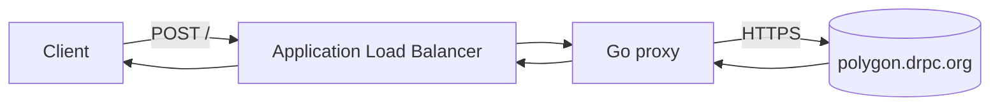

# Polygon JSON-RPC proxy


A small Go reverse proxy for `https://polygon.drpc.org`, with automated tests
and Terraform for deployment to AWS ECS Fargate.

The proxy forwards JSON-RPC payloads without implementing blockchain protocol
semantics. It adds bounded resource use, request correlation, structured logs,
and method-aware Prometheus metrics.

## Request flow



## Quick start

Use the Go version declared in [`go.mod`](go.mod):

```bash
make run
```

Then send a Polygon request:

```bash
curl -sS -X POST http://localhost:8080/ \
  -H 'Content-Type: application/json' \
  -d '{"jsonrpc":"2.0","id":1,"method":"eth_blockNumber","params":[]}'
```

The default upstream can be replaced without changing code:

```bash
UPSTREAM_URL=http://127.0.0.1:8545 make run
```

## HTTP interface

| Method and path | Behavior |
|---|---|
| `POST /` | Forward a single or batch JSON-RPC payload |
| `OPTIONS /` | Forward CORS preflight to the upstream |
| `GET /healthz` | Report process liveness |
| `GET /metrics` | Expose Prometheus and Go runtime metrics |

Request bodies are buffered up to the configured limit so the method name can
be inspected for telemetry. The original bytes are then forwarded unchanged.
Malformed JSON, batches, and JSON-RPC errors remain the upstream's
responsibility.

Errors generated by the proxy use standard HTTP status codes. Upstream status
codes, response bodies, and end-to-end application headers are relayed to the
client. Response bodies are streamed rather than buffered.

## Configuration

All settings are optional environment variables:

| Variable | Default | Purpose |
|---|---|---|
| `UPSTREAM_URL` | `https://polygon.drpc.org` | Upstream RPC endpoint |
| `LISTEN_ADDR` | `:8080` | Server bind address |
| `UPSTREAM_TIMEOUT` | `30s` | Maximum upstream request duration |
| `MAX_BODY_BYTES` | `1048576` | Maximum buffered request body |
| `MAX_IN_FLIGHT` | `128` | Concurrent forwarding limit |
| `SHUTDOWN_TIMEOUT` | `10s` | Graceful shutdown deadline |

Invalid configuration stops the process during startup.

## Operational design

- Admission control rejects excess work with `503 Service Unavailable` before
  reading the request body.
- Request size and upstream duration are bounded, upstream connections are
  capped, and server timeouts limit slow clients. Cancellation propagates
  upstream.
- `SIGINT` and `SIGTERM` start a graceful shutdown with a fixed drain period.
- A valid inbound `X-Request-Id` is preserved. Otherwise the proxy generates
  one and returns it to the client and upstream.
- Each proxied request produces one structured log with the request ID, method
  label, status, and duration.
- The metrics handler permits one concurrent scrape independently of RPC
  admission.

Prometheus metrics include:

- `rpc_proxy_requests_total{method,code}`
- `rpc_proxy_request_duration_seconds{method}`
- `rpc_proxy_upstream_errors_total{cause}`
- `rpc_proxy_in_flight_requests`

Client-derived method labels are syntax-checked and capped at 100 distinct
values per process. Additional labels are reported as `other`.

## Test and build

```bash
make test          # race-enabled Go tests
make lint          # formatting, vet, GolangCI-Lint, and tests
make scan          # Go vulnerability analysis
make image         # local container image
make tf-validate   # Terraform format and validation
make shellcheck    # deployment script linting
```

Tests cover payload and header forwarding, batches, CORS, compression,
request IDs, resource limits, cancellation, upstream failures, telemetry, and
graceful shutdown. CI also scans dependencies, the container image,
Dockerfile, and Terraform configuration.

The runtime image contains a static binary, runs as a non-root user, and uses
a pinned distroless base image.

## Deploy to AWS

Deployment requires Terraform, AWS CLI v2, Git, `curl`, `jq`, and Docker or
Podman. The default region is `eu-central-1`. The stack creates billable AWS
resources and serves HTTP without requiring a domain.

```bash
make aws-deploy
```

The deployment workflow verifies the AWS identity and Git state, creates the
infrastructure, publishes the current commit to ECR, resolves its immutable
digest, updates ECS, waits for healthy targets, and runs end-to-end checks.

TLS is optional. To let Terraform manage a Route 53 alias and ACM certificate,
copy the example and set a hostname in an existing public hosted zone:

```bash
cp terraform/deployment.tfvars.example terraform/deployment.tfvars
# Edit public_hostname and route53_zone_id.
make aws-deploy
```

Rerun deployed checks or remove the stack with:

```bash
make aws-smoke
make aws-destroy
```

See [terraform/README.md](terraform/README.md) for topology, inputs, optional
controls, and teardown behavior.

## Design choices and limitations

- Fargate tasks run without public IPs behind an ALB. The container filesystem
  is read-only, the application task role has no permissions, and task egress
  is limited to TCP 443.
- ECR tags are immutable and ECS receives the resolved image digest rather
  than a mutable tag.
- The default deployment uses one NAT gateway and pins the service to the same
  availability zone. This controls cost but creates a single-AZ dependency.
- `/metrics` is exposed by the default ALB route and reveals aggregate traffic
  and runtime information.
- Terraform state is local and intended for one operator. Preserve it until
  the stack has been destroyed and do not run concurrent applies.
- Authentication, per-client rate limiting, caching, retries, failover,
  WebSockets, and JSON-RPC validation are outside this implementation.

## License

[MIT](LICENSE)
