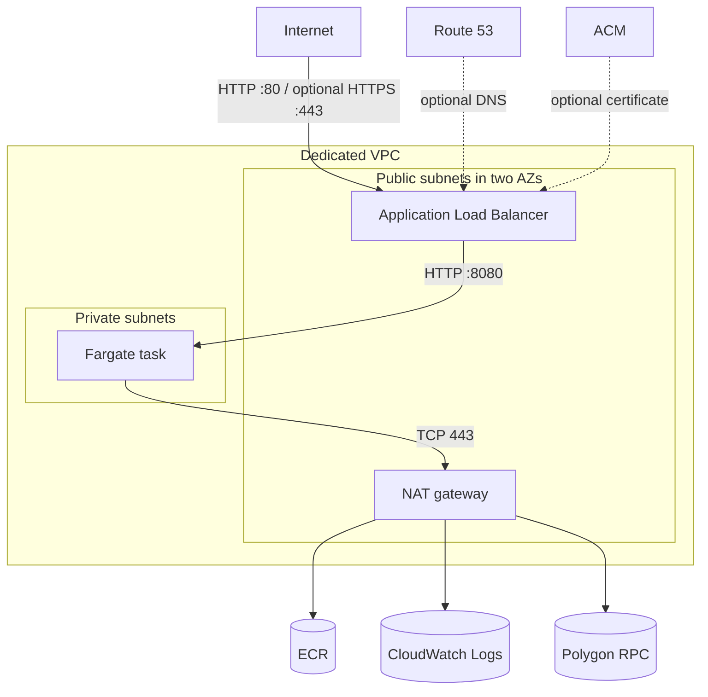

# AWS deployment

This Terraform root deploys the proxy to ECS Fargate in a dedicated VPC. An
internet-facing Application Load Balancer is the only ingress path. The task
runs in a private subnet without a public IP and reaches Polygon through a NAT
gateway.

HTTP on port 80 is the default. When a public Route 53 zone and hostname are
provided, Terraform also manages an ACM certificate, HTTPS listener, HTTP
redirect, and service alias.



The task uses an empty application IAM role, a separate ECS execution role,
a read-only root filesystem, and security groups that permit ingress only
from the ALB. Images are stored in ECR with immutable tags and deployed to ECS
by digest.

## Requirements

- Terraform 1.5 or later
- AWS provider `~> 6.55`
- AWS CLI v2 and credentials allowed to create the stack
- Git, `curl`, and `jq`
- Docker or Podman

The stack creates billable resources, including a NAT gateway, public IPv4
address, ALB, Fargate task, and CloudWatch log storage.

## Deploy

Run from the repository root with a clean Git checkout:

```bash
make aws-deploy
```

The workflow validates its tools, Terraform configuration, Git state, and AWS
identity. On a new stack it creates ECR with zero running tasks, builds the
current commit for Linux AMD64, pushes it under the full commit SHA, and
resolves the registry digest. Terraform then applies a saved release plan,
waits for ECS and ALB health, then waits up to five minutes for public DNS,
listener, and certificate propagation before running the deployed smoke tests.
TLS verification remains enabled throughout.

An existing immutable commit tag is reused. The selected digest and desired
task count are written to ignored
`terraform/generated.auto.tfvars.json`; the file contains no credentials.

## Optional TLS

Copy the example file and set both values:

```bash
cp terraform/deployment.tfvars.example terraform/deployment.tfvars
```

```hcl
public_hostname = "polygon.rpc.example.com"
route53_zone_id  = "Z0123456789ABCDEFGHIJ"
```

The zone must be public and contain the configured hostname. Terraform creates
the DNS validation record, ACM certificate, HTTPS listener, HTTP redirect, and
service alias. It does not manage the registered domain or hosted zone, and
those resources are preserved during destroy.

`terraform/deployment.tfvars` is loaded automatically. Use `TF_VARS_FILE` to
select another file.

## Verify and destroy

Run the deployed checks again without changing AWS infrastructure:

```bash
make aws-smoke
```

The suite checks AWS health, HTTP and TLS behavior, representative Polygon
calls, request correlation in CloudWatch Logs, and Terraform drift.

Its first line reports the selected variable source. If no
`terraform/deployment.tfvars` or `TF_VARS_FILE` exists, it evaluates the HTTP
defaults. Keep that selection consistent with the deployment being checked;
otherwise the final plan correctly reports the configuration difference.

Validate the local Terraform and shell code separately with:

```bash
make tf-validate
make shellcheck
```

Destroy the application stack when finished:

```bash
make aws-destroy
```

The command shows the AWS identity and destroy plan, then requires explicit
confirmation. It removes ECR images and Terraform-managed TLS resources while
preserving the external hosted zone and domain.

## Operator controls

| Variable | Purpose |
|---|---|
| `EXPECTED_AWS_ACCOUNT_ID` | Fail before planning if credentials target another account |
| `CONTAINER_ENGINE` | Select `docker` or `podman` explicitly |
| `TF_VARS_FILE` | Load a different Terraform variables file |
| `SMOKE_RESOLVE_IP` | Test a specific ALB address while diagnosing local DNS |
| `SMOKE_READY_TIMEOUT` | Override the public endpoint readiness timeout in seconds (default `300`) |
| `DEPLOY_ALLOW_DIRTY=1` | Permit a uniquely tagged diagnostic image from a dirty tree |
| `TF_AUTO_APPROVE=1` | Bypass deploy confirmations in trusted automation |
| `DESTROY_AUTO_APPROVE=1` | Bypass destroy confirmation in trusted automation |

Release deployments should use a clean checkout. Set
`EXPECTED_AWS_ACCOUNT_ID` in automation and retain confirmation prompts for
interactive use.

## Inputs

| Name | Default | Description |
|---|---|---|
| `app_name` | `polygon-rpc-proxy` | AWS resource name prefix |
| `region` | `eu-central-1` | AWS region |
| `public_hostname` | `null` | Hostname for managed TLS |
| `route53_zone_id` | `null` | Existing public hosted zone ID |
| `vpc_cidr` | `10.0.0.0/16` | Dedicated VPC CIDR |
| `image_digest` | `null` | ECR digest; null only during zero-task bootstrap |
| `container_port` | `8080` | Container and target-group port |
| `desired_count` | `1` | Number of Fargate tasks |
| `max_in_flight` | `128` | Concurrent forwarding limit per task |
| `task_cpu` | `256` | Fargate CPU units |
| `task_memory` | `512` | Fargate memory in MiB |
| `upstream_url` | `https://polygon.drpc.org` | HTTPS RPC endpoint on port 443 |
| `log_retention_days` | `7` | CloudWatch Logs retention |

TLS inputs must be supplied together. Running tasks require a valid SHA-256
image digest. Terraform also validates the upstream URL, ports, concurrency,
Fargate CPU and memory combination, and log retention value.

Run `terraform -chdir=terraform output` after deployment to view the public
RPC URL, ECR repository, ECS names, target group, log group, and region.

## State and availability

- State is local for a single operator. Preserve it until destroy completes
  and do not run concurrent applies.
- The ALB spans two public subnets, but one NAT gateway is used and the service
  is pinned to its availability zone. This reduces cost while creating a
  single-AZ task and egress dependency.
- `/metrics` is reachable through the public listener and exposes aggregate
  traffic and runtime information.
- HTTP remains available without domain ownership. Managed TLS requires an
  existing public Route 53 zone.

See the root [README](../README.md) for proxy behavior and local development.
